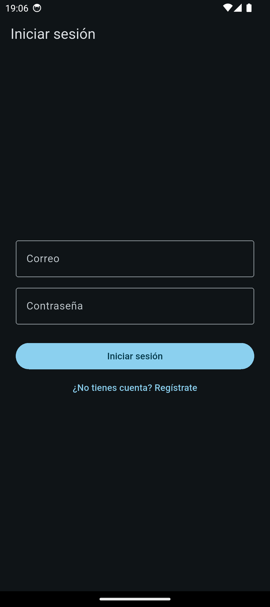
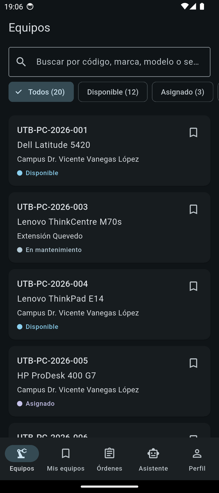
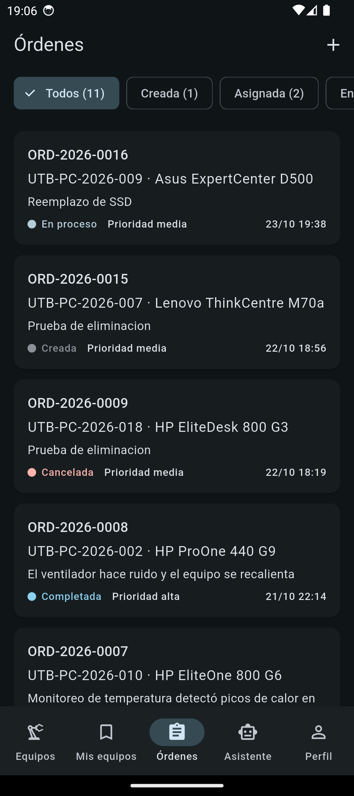
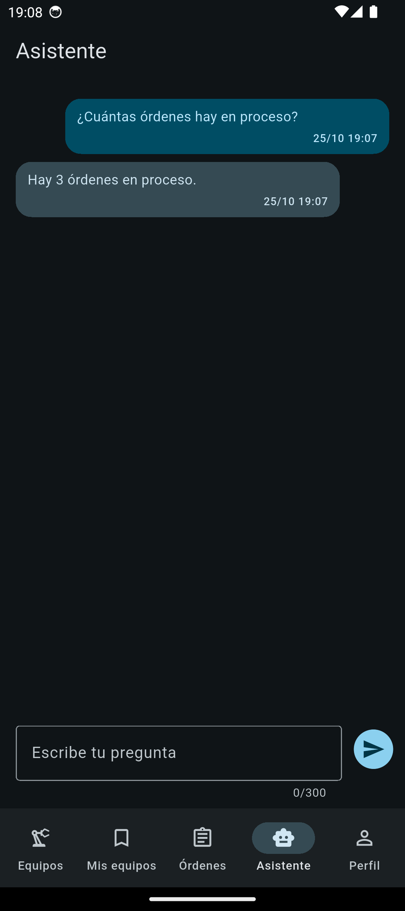
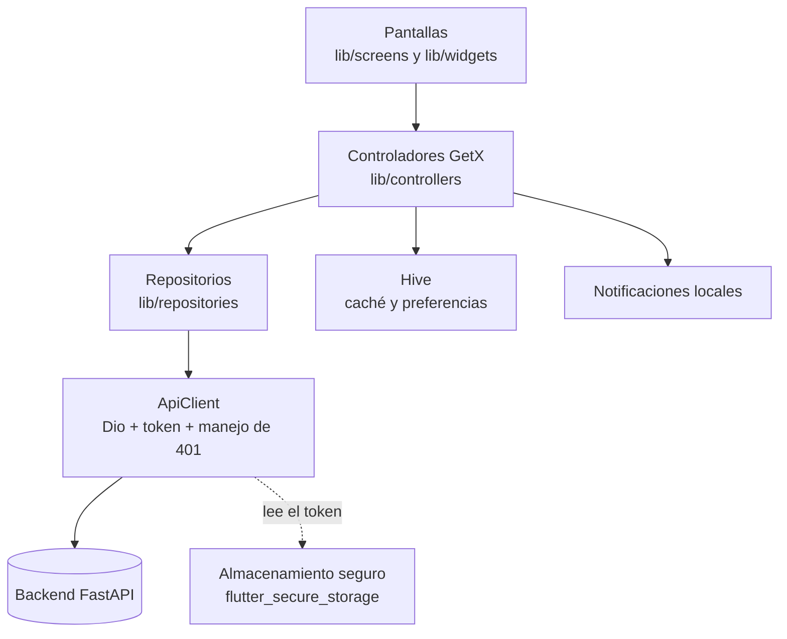

# Mantenimiento DTSI

App móvil Flutter para la gestión de mantenimiento de equipos de la DTSI de la UTB, sobre un backend FastAPI propio.

- Backend: [agustin-ec/mantenimiento-equipos-dtsi-utb](https://github.com/agustin-ec/mantenimiento-equipos-dtsi-utb)
- Release más reciente: [releases/latest](https://github.com/agustin-ec/mantenimiento-dtsi-app/releases/latest) (versión actual: v1.0.1, archivo `mantenimiento-dtsi.apk`)

## 1. Qué hace

| Pantalla o módulo | Qué permite |
|---|---|
| Registro e inicio de sesión | Crear una cuenta e iniciar sesión con el backend (JWT). La sesión se restaura al abrir la app y las rutas se protegen según haya sesión. |
| Equipos | Lista con búsqueda de texto (sin distinguir mayúsculas ni tildes) y filtro por estado. Tiene estados de carga, vacío y error, y un aviso cuando se muestran datos guardados en el dispositivo. |
| Detalle de equipo | Datos del equipo, su historial de intervenciones y el botón para seguirlo. |
| Mis equipos | Equipos que la persona decidió seguir; los ids se guardan en el dispositivo. |
| Órdenes | Lista de órdenes de mantenimiento y creación de una orden nueva desde un formulario. |
| Detalle de orden | Acciones **iniciar**, **completar** y **cancelar** según el estado de la orden; **asignar técnico** solo para el rol administrador (con la orden creada o asignada); **eliminar** solo con la orden creada, para quien la solicitó o un administrador. La interfaz solo guía: el servidor decide. |
| Asistente de IA | Chat con preguntas de ejemplo; las preguntas se envían al backend. |
| Notificaciones locales | Avisos cuando cambia el estado de las órdenes en las que la persona es solicitante o técnico. |
| Perfil | Datos de la persona, selector de tema (sistema, claro u oscuro) y cierre de sesión. |

### Capturas de pantalla

<table>
  <tr>
    <td align="center"></td>
    <td align="center"></td>
    <td align="center"></td>
    <td align="center"></td>
  </tr>
  <tr>
    <td valign="top">Inicio de sesión en tema oscuro, con los campos Correo y Contraseña, el botón «Iniciar sesión» y el enlace «¿No tienes cuenta? Regístrate».</td>
    <td valign="top">Lista de equipos con buscador, filtros por estado y tarjetas con código, modelo, sede y estado; abajo, la barra con cinco pestañas.</td>
    <td valign="top">Lista de órdenes con filtros por estado, botón «+» y tarjetas con código de orden, equipo, descripción, estado, prioridad y fecha.</td>
    <td valign="top">Chat del asistente con la pregunta «¿Cuántas órdenes hay en proceso?» y la respuesta «Hay 3 órdenes en proceso.», y el campo «Escribe tu pregunta» con contador de 300 caracteres.</td>
  </tr>
</table>

## 2. Arquitectura



Las pantallas no llaman a la red ni a Hive directamente: todo pasa por los controladores.

| Carpeta de `lib/` | Contenido |
|---|---|
| `screens/` | Pantallas completas (arranque, login, registro, inicio con pestañas, equipos, órdenes, asistente, perfil y sus detalles). |
| `widgets/` | Componentes reutilizables: tarjetas, diálogos, hojas inferiores, vistas de error y de vacío, chips de filtro. |
| `controllers/` | Estado compartido con GetX. |
| `repositories/` | Acceso a los datos del backend (autenticación, equipos, órdenes, asistente). |
| `services/` | Cliente HTTP (`ApiClient`), almacén seguro del token, cachés en Hive, avisos de órdenes y servicio de notificaciones. |
| `models/` | Modelos de datos: equipo, orden, usuario, técnico, evento de historial, mensaje del asistente. |
| `theme/` | Tema claro y oscuro. |
| `utils/` | Rutas, protección de rutas, sesión, validadores y utilidades de texto. |

### Decisiones técnicas

| ELEGÍ | DESCARTÉ | POR QUÉ |
|---|---|---|
| Consumir el asistente de IA a través del backend (`POST /asistente/preguntar`). | Guardar la clave del modelo dentro de la app o pedírsela a cada persona. | Una clave dentro de un APK puede extraerse; en el servidor queda protegida. |
| Usar la caché de equipos solo ante fallos de red y errores 5xx (`ApiException.permiteCache`). | Usar la caché con cualquier error. | Con 401, 404 o 422 el problema no es la red y mostrar datos viejos engañaría. |

## 3. Requisitos y cómo ejecutarla

- Dart `^3.13.5` (según `pubspec.yaml`). El proyecto no declara una versión mínima de Flutter; se desarrolló con Flutter 3.47.7 (canal stable).
- Android (emulador o teléfono) y Docker para el backend.

**Backend.** En la carpeta del backend, crea su `.env` a partir de `.env.example` (ahí se definen, entre otras cosas, las claves de siembra de los usuarios) y levántalo:

```bash
docker compose up -d --build
```

Queda en el puerto 8001 y su documentación interactiva en http://localhost:8001/docs.

**App.**

```bash
flutter pub get
flutter run
flutter analyze
flutter test
```

**Dirección del backend.** Por defecto la app usa `http://10.0.2.2:8001`, que es el equipo anfitrión visto desde el emulador de Android. Para otra dirección (por ejemplo un teléfono físico) se cambia al compilar:

```bash
flutter run --dart-define=API_BASE_URL=http://<dirección>:8001
```

## 4. Instalar el APK

1. Descarga `mantenimiento-dtsi.apk` desde la [última Release](https://github.com/agustin-ec/mantenimiento-dtsi-app/releases/latest) (versión actual: v1.0.1).
2. En un emulador, arrastra el archivo a la ventana o instálalo con `adb install`. En un teléfono, ábrelo y permite la instalación desde esa fuente cuando Android lo pida.
3. Abre «Mantenimiento DTSI».

> **Advertencia:** el APK apunta por defecto a `http://10.0.2.2:8001`. Por eso funciona en el emulador con el backend local encendido; en un teléfono físico no encontrará el servidor a menos que se compile con otra dirección. La Release publicada usa la variable `API_BASE_URL` de GitHub Actions si está definida; si no, esa dirección.

## 5. Usuarios de prueba

Cualquier persona puede registrarse desde la app. Los usuarios con rol de técnico y de administrador los crea la siembra del backend, con claves definidas en el `.env` del backend (a partir de su `.env.example`). Este repositorio no incluye ninguna clave.

## 6. Seguridad

- El token JWT solo se guarda en el almacenamiento seguro (`flutter_secure_storage`); no se escribe en Hive ni en registros, y el código de la app no usa `print` ni registros.
- La app no contiene ninguna clave de IA: el asistente vive en el backend y la app solo le envía la pregunta.
- El tráfico HTTP sin cifrar está permitido únicamente hacia `10.0.2.2` y `localhost` (`network_security_config.xml`).
- Hive guarda solo cachés y estados sin datos sensibles: preferencia de tema, si ya se pidió el permiso de notificaciones, ids de equipos seguidos, caché de equipos y el último estado conocido de cada orden.
- `.env` está en `.gitignore`.

## 7. Pruebas, integración continua y Release

La suite tiene **431 pruebas** (`flutter test`) y `flutter analyze` termina sin problemas.

| Flujo (`.github/workflows/`) | Cuándo corre | Qué hace |
|---|---|---|
| `ci.yml` | Push a cualquier rama, pull request o ejecución manual | Instala Java 17 y Flutter, descarga dependencias, ejecuta `flutter analyze --no-fatal-infos` y `flutter test`. No publica nada. |
| `release-apk.yml` | Etiqueta `v*` o ejecución manual | Analiza y prueba, compila `flutter build apk --release` con `API_BASE_URL` (la variable de GitHub o `http://10.0.2.2:8001`), renombra el archivo a `mantenimiento-dtsi.apk` y lo sube como artefacto. Solo con etiqueta crea además la Release con el APK adjunto. |

Para publicar una versión se sube una etiqueta nueva, por ejemplo `v1.0.2`; sin etiqueta nueva no se crea Release.

## 8. Limitaciones conocidas

- Los avisos de cambios de estado solo llegan con la app abierta: no hay servicio en segundo plano.
- El asistente no tiene memoria de conversación (el historial vive solo en memoria de la app) y solo conoce conteos y códigos.
- Las órdenes no se guardan sin conexión; solo los equipos tienen caché local.
- El APK usa por defecto la dirección del emulador.
- Hive no está cifrado.

## 9. Desarrollo asistido por IA

Se usó un agente de IA en modo plan, con las pruebas escritas primero. Cada cambio fue revisado y aprobado por el autor, que hizo los commits.

## 10. Créditos y licencias

Dependencias directas de `pubspec.yaml` (licencia tomada del archivo `LICENSE` de cada paquete):

| Paquete | Versión | Licencia |
|---|---|---|
| get | 4.7.3 | MIT |
| dio | 5.11.1 | MIT |
| flutter_secure_storage | 11.2.0 | BSD 3-Clause |
| hive | 2.2.3 | Apache 2.0 |
| hive_flutter | 1.1.0 | Apache 2.0 |
| flutter_local_notifications | 22.3.2 | BSD 3-Clause |
| cupertino_icons | 1.0.9 | MIT |
| flutter_lints (desarrollo) | 6.0.0 | BSD 3-Clause |
| flutter_launcher_icons (desarrollo) | 0.14.4 | MIT |

- Icono: generado con Gemini y retocado con Canva.
- Datos del personal de la DTSI: publicados por la institución.
- Proyecto realizado en el curso de CEDIA.

---

[Licencia MIT](LICENSE)
